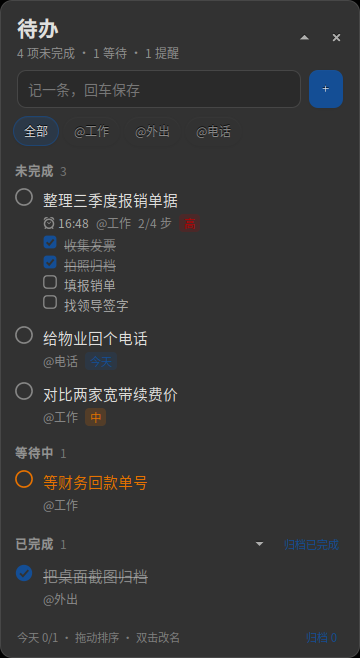
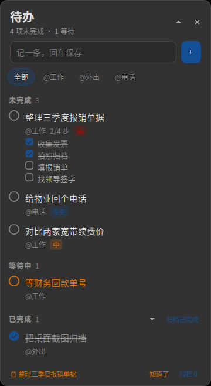

# 桌面待办

> 常驻桌面右上角的待办清单挂件：**回车就记一条**，三种状态、子步骤、情境标签、到点提醒。
> 单文件，Python 标准库 + 系统 GTK3（PyGObject），**不联网、无账号**。只服务 **统信 UOS / deepin（X11）**。
>
> **本版 v0.5.0**（首个商店版本）：新增备份 / 导出 / 导入、数据格式版本与迁移、Wayland 会话提示、
> 全文搜索、中英文界面，以及可复现构建与一键自检；界面仍是 GTK3 / Adwaita 原生（v0.4.0 起）。
> 依赖不变（`python3-gi` + `gir1.2-gtk-3.0`，系统包，安装包会自动装）；数据格式向后兼容，从旧版升级会沿用原数据。



## 下载

- 安装包（推荐）：[desktop-todo_0.5.0_all.deb](desktop-todo_0.5.0_all.deb)（76K）
- 源码：[desktop_todo.py](desktop_todo.py)（单文件，`python3 desktop_todo.py` 直接运行）
- 校验：deb 的 SHA256 `eb58d09a6475059f0d9761bf6559a38bc8c91134465344af0ee25eab8f4239bc`；完整清单见 `SHA256SUMS`（**源码与安装包各一行**），
  在同时下载两个文件后运行 `sha256sum -c SHA256SUMS`

## 安装（三步）

1. 下载本仓库根目录的 `desktop-todo_0.5.0_all.deb`
2. **双击**，按提示输入密码安装
3. 打开**启动器**，搜「桌面待办」

装完右键标题栏可以勾「开机自启」。卸载：`sudo dpkg -r desktop-todo`（**数据不会被删**，
想彻底清掉再删 `~/.local/share/desktop-todo/`）。

> 安装包没有代码签名，系统可能提示「来源未知」——这是正常的，对照 `SHA256SUMS` 核对即可。

## 功能

- **三种状态**：未完成 / 等待中（已着手、在等别人反馈）/ 已完成
- **GTK3 原生界面**：Pango 排版、主题 symbolic 图标、CSS；默认深色 Adwaita，
  `DESKTOP_TODO_THEME=light` 切浅色、`=system` 跟随系统；默认 360px 宽，可拉宽，
  内容列最宽 520 居中
- **子步骤**：一件事拆成最多 20 步，单独勾选，不影响主条目
- **今天要办的**与**优先级**：标了今天的浮到最前，高/中优先级在元信息行有徽标
- **情境标签**：正文写 `@电话` 自动成标签，点标签只看这一类
- **到点提醒**：右键条目设 `HH:MM`，到点窗口提前 + 底部横幅；关机错过的下次启动补报
- **拖拽排序**、双击改名、删除 8 秒内可撤销，删掉的进归档可找回
- **唤回**：全局快捷键 `Super+T`，或再运行一次程序（不会开第二个窗口）



## 它不联网（可以自己验）

```bash
grep -nE "AF_INET|urllib|http|requests|getaddrinfo" desktop_todo.py   # 无输出
grep -nE "subprocess|os\.system|Popen" desktop_todo.py                # 无输出
sha256sum desktop_todo.py                                             # 对照 SHA256SUMS 源码行
sha256sum -c SHA256SUMS                                               # 整包校验（含 deb 行）
```

数据只写 `~/.local/share/desktop-todo/todos.json`（原子写入，损坏自动备份）。
详见 [SECURITY.md](SECURITY.md)。

## 环境

- 统信 UOS / deepin，**X11** 会话（Wayland 下可运行，但全局快捷键 / 置顶不可用，程序会检测并提示）
- Python 3 + 系统 GTK3：`python3-gi`、`gir1.2-gtk-3.0`，X11 下还需要 `libx11-6`；
  安装包会自动处理依赖（都不需要用 pip 装）

## 许可

MIT，见 [LICENSE](LICENSE)。

> 本仓库由开发仓自动发布；同一份内容同时镜像在 GitHub 与 Gitee。
