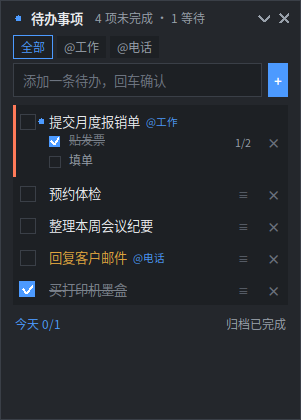
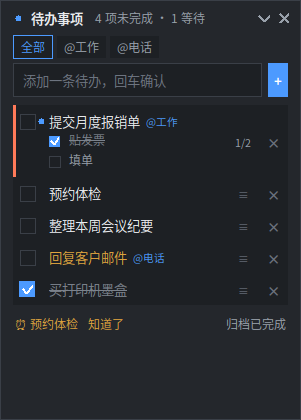

# 桌面待办

> 常驻桌面右上角的待办清单挂件：**回车就记一条**，三种状态、子步骤、情境标签、到点提醒。
> 单文件、只用 Python 标准库、**不联网、无账号**。只服务 **统信 UOS / deepin（X11）**。



## 下载

- 安装包（推荐）：[desktop-todo_0.2.2_all.deb](desktop-todo_0.2.2_all.deb)（72K）
- 源码：[desktop_todo.py](desktop_todo.py)（单文件，`python3 desktop_todo.py` 直接运行）
- 校验：`d4e9d49e06e2886e911f9bf122797c5b62fb9282cbea0170f99c421c2db39670`（SHA256，记录在 `SHA256SUMS`）

## 安装（三步）

1. 下载本仓库根目录的 `desktop-todo_0.2.2_all.deb`
2. **双击**，按提示输入密码安装
3. 打开**启动器**，搜「桌面待办」

装完右键标题栏可以勾「开机自启」。卸载：`sudo dpkg -r desktop-todo`（**数据不会被删**，
想彻底清掉再删 `~/.local/share/desktop-todo/`）。

> 安装包没有代码签名，系统可能提示「来源未知」——这是正常的，对照上面的 SHA256 核对即可。

## 功能

- **三种状态**：未完成 / 等待中（已着手、在等别人反馈）/ 已完成
- **子步骤**：一件事拆成最多 20 步，单独勾选，不影响主条目
- **今天要办的**与**优先级**：标了今天的浮到最前，高优先级行左侧有颜色标记
- **情境标签**：正文写 `@电话` 自动成标签，点标签只看这一类
- **到点提醒**：右键条目设 `HH:MM`，到点窗口提前 + 底部横幅；关机错过的下次启动补报
- **拖拽排序**、双击改名、删除 8 秒内可撤销，删掉的进归档可找回
- **唤回**：全局快捷键 `Super+T`，或再运行一次程序（不会开第二个窗口）



## 它不联网（可以自己验）

```bash
grep -nE "AF_INET|urllib|http|requests|getaddrinfo" desktop_todo.py   # 无输出
grep -nE "subprocess|os\.system|Popen" desktop_todo.py                # 无输出
sha256sum desktop_todo.py
```

数据只写 `~/.local/share/desktop-todo/todos.json`（原子写入，损坏自动备份）。
详见 [SECURITY.md](SECURITY.md)。

## 环境

- 统信 UOS / deepin，**X11** 会话（不支持 Wayland）
- Python 3 + tkinter（`python3-tk`）；安装包会自动处理依赖

## 许可

MIT，见 [LICENSE](LICENSE)。

> 本仓库由开发仓自动发布；同一份内容同时镜像在 GitHub 与 Gitee。
